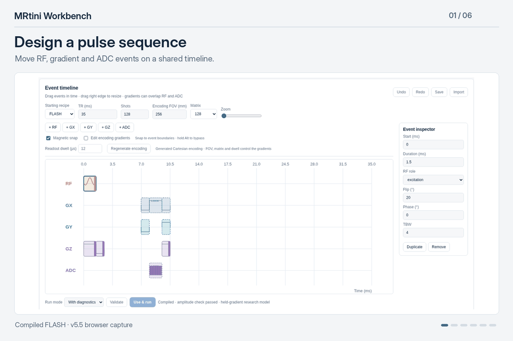

## MRTini Workbench

**Design MRI sequences. Simulate acquisitions. Understand the signal.**
<p align="center">
  
</p>
MRTini includes an interactive, browser-based research workbench for MRI sequence development, numerical simulation and magnetization pathway analysis.

- **Sequence design:** Build custom sequences using an interactive multitrack RF, gradient and ADC editor with live waveform and trajectory previews.
- **GPU-accelerated simulation:** Simulate acquisitions using MRTini's phase distribution graph engine with finite RF pulse modelling.
- **MRI reconstruction:** Explore Cartesian and non-Cartesian acquisitions using trajectory-aware reconstruction and density compensation.
- **RF physics:** Investigate slice profiles, Fourier coefficients, cross-order coupling and magnetization evolution.
- **Pathway analysis:** Inspect water/fat phase distribution graphs, trace contributing magnetization states and analyse spatial and temporal refocusing.
- **Experiment exploration:** Compare acquisitions, perform parameter sweeps and inspect measured DICOM references.

### Launch the Workbench

From the repository root:

```bash
python -m pip install -r mrtini_workbench/requirements.txt
python workbench.py
```

Open `http://127.0.0.1:8765` in your browser.